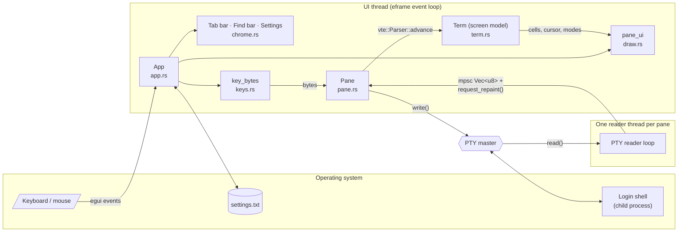
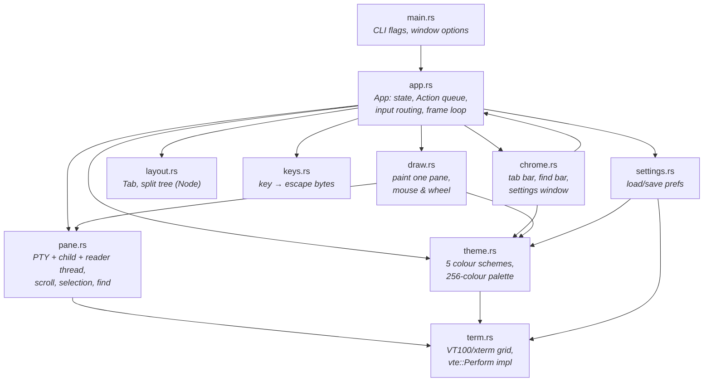
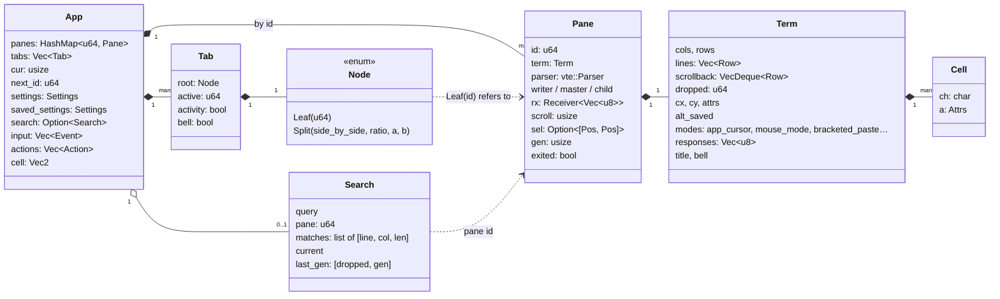
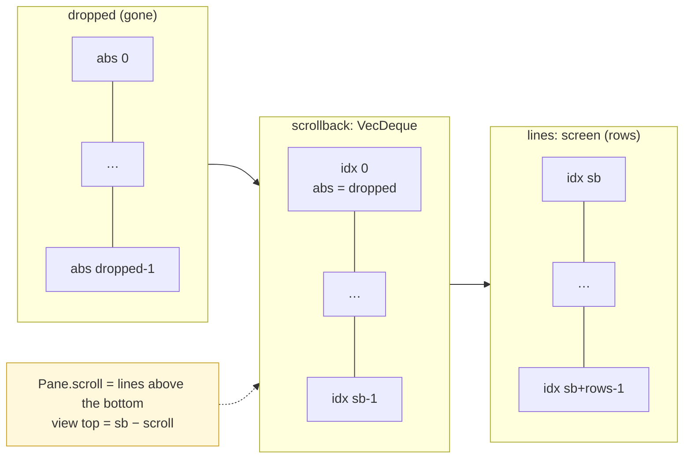
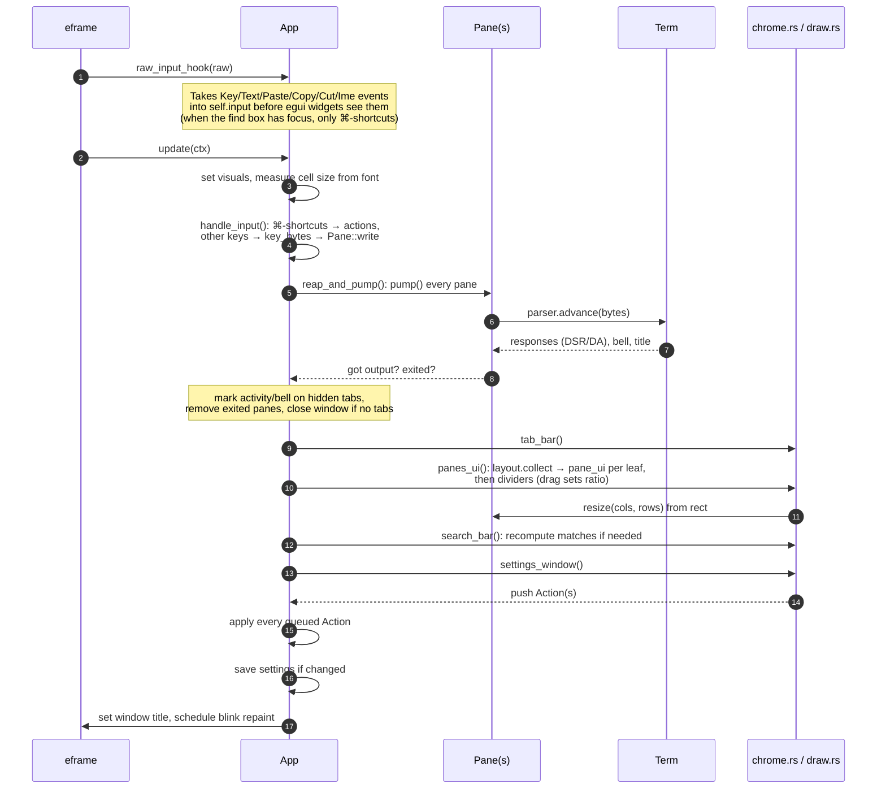
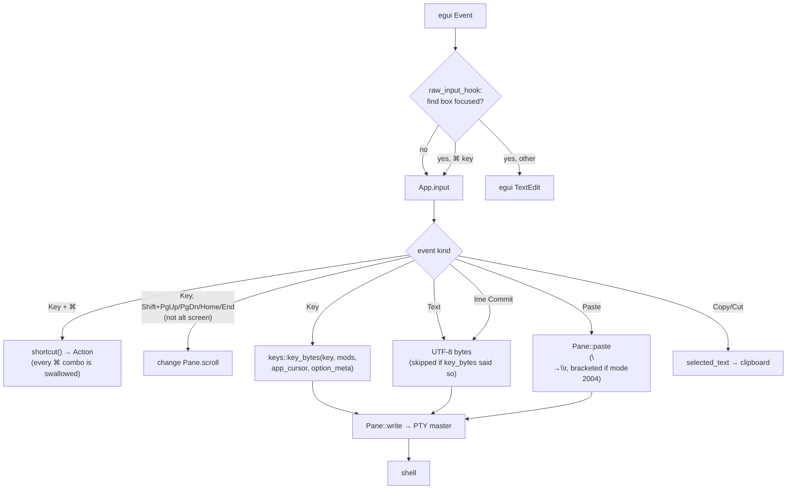
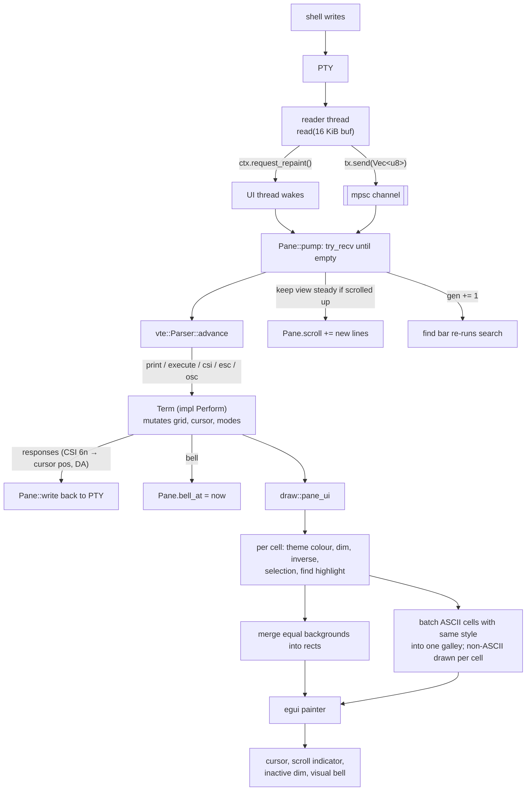
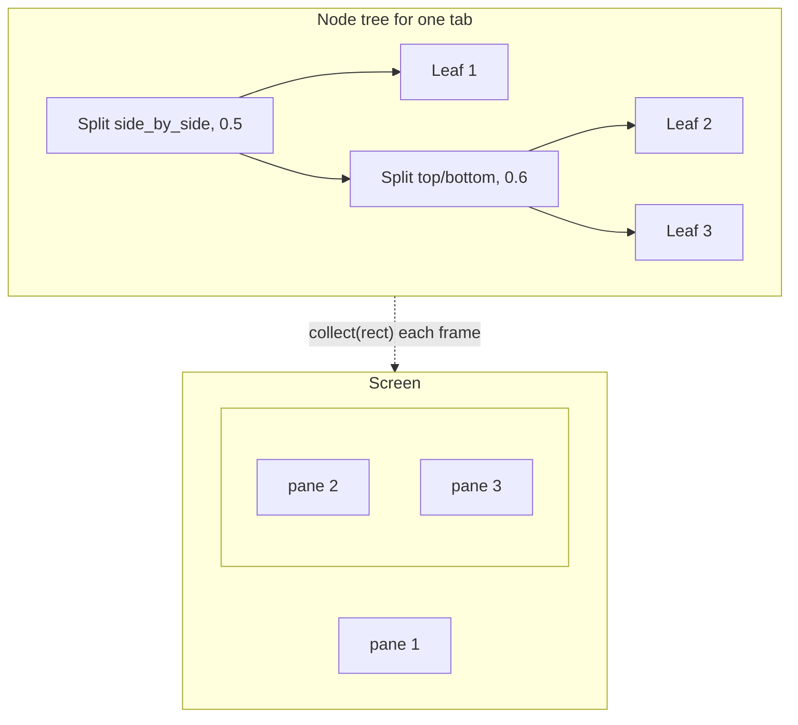
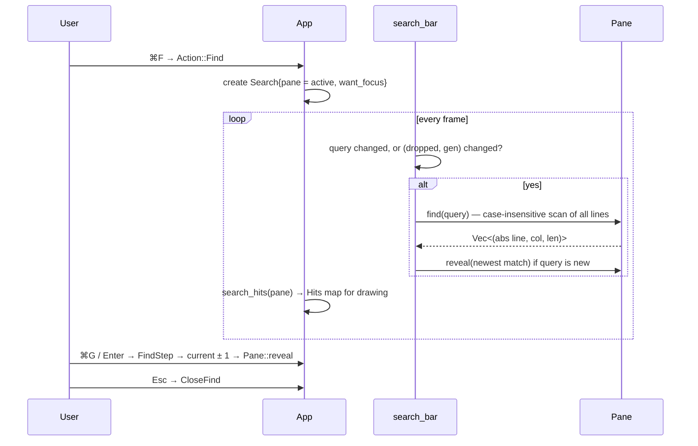
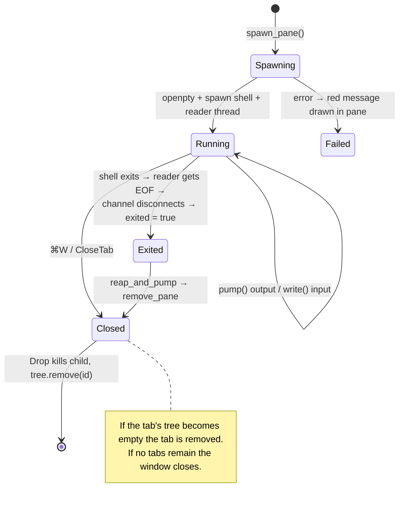

# MyTerm Architecture

MyTerm is a single-window terminal emulator for macOS written in Rust (~2,900 lines).
It uses [egui/eframe](https://github.com/emilk/egui) for the window and drawing,
[`portable-pty`](https://crates.io/crates/portable-pty) to run the shell, and
[`vte`](https://crates.io/crates/vte) to parse escape sequences. MyTerm itself
implements the terminal screen model, the split-pane layout, input encoding,
selection, find, and settings.

This document describes the code as it is. File references point to `src/`.

---

## 1. The big picture



There are two kinds of thread:

- **The UI thread** owns all state: `App`, every `Pane`, and every `Term`. It reads
  input, parses shell output, lays out the panes, and draws, all inside eframe's
  `update()` callback. Writes to the shell also happen here, synchronously.
- **One reader thread per pane** (`pane.rs:84`) blocks on `read()` from the PTY. It
  sends each chunk of bytes over a `std::sync::mpsc` channel and calls
  `ctx.request_repaint()` to wake the UI thread.

The channel is the only thing the threads share, so no locks are needed. The
reader thread never touches the `Term`. Parsing happens later on the UI thread,
in `Pane::pump()`.

---

## 2. Modules



| Module | Responsibility | Key types / functions |
|---|---|---|
| `main.rs` | Reads `--screenshot <png>` and `--demo`, opens a 740×470 window | `main` |
| `app.rs` | Owns all state. Filters raw input, runs the per-frame pipeline, applies `Action`s | `App`, `Action`, `Search`, `raw_input_hook`, `update` |
| `chrome.rs` | Draws everything around the terminals. Extra `impl App` blocks | `tab_bar`, `search_bar`, `settings_window` |
| `draw.rs` | Draws one pane's cells, cursor, and overlays. Handles mouse selection, mouse reporting, and the wheel | `pane_ui`, `DrawCtx`, `Hits`, `mouse_report` |
| `layout.rs` | Binary tree of splits inside a tab. Computes each pane's rectangle and the dividers | `Node`, `Tab`, `Divider` |
| `pane.rs` | One shell session: PTY, child process, reader thread, scroll position, selection, find | `Pane`, `Pos` |
| `term.rs` | Terminal screen model: grid, scrollback, cursor, modes, SGR. Implements `vte::Perform` | `Term`, `Cell`, `Attrs`, `Color` |
| `keys.rs` | Pure function that turns an egui key plus modifiers into xterm byte sequences | `key_bytes` |
| `theme.rs` | Static colour tables and the logic that maps a `Color` to an on-screen colour | `Theme`, `THEMES` |
| `settings.rs` | Preferences as `key=value` text in `~/Library/Application Support/MyTerm/settings.txt` | `Settings::load`, `save` |

`term.rs`, `keys.rs`, and `layout.rs` don't use egui's UI types (`layout.rs` uses only
`egui::Rect` for geometry). This keeps them easy to unit-test, and they hold all of
the project's tests.

---

## 3. Data model



### Panes are referenced by id, not owned by the tree

`App.panes` is a flat `HashMap<u64, Pane>`. Tabs and the split tree hold only
`u64` ids (`Node::Leaf(id)`). Because of this:

- The layout tree can be rebuilt (`Node::remove` consumes and returns a new tree)
  without moving sessions.
- `reap_and_pump` can loop over every pane in one pass, visible or not.
- Ids come from `next_id` and are never reused, so a stale id (for example in
  `Search.pane`) finds nothing instead of finding the wrong pane.

### Absolute line numbers

Scrollback is capped at `scrollback_limit` lines, so old lines are removed from the
front over time. To keep positions valid as that happens, `Term` counts every line
it has ever dropped in `dropped: u64`. A `Pos { line, col }` uses an **absolute**
line number:

```
absolute line = dropped + index into (scrollback ++ screen)
```

`Term::abs_to_idx` (`term.rs:170`) turns it back into an index, or returns `None`
if the line has been dropped. The selection (`Pane.sel`), find matches
(`Search.matches`), and `Pane::reveal` all use absolute lines, so they stay on the
right text while output scrolls. `clear_buffer` and `CSI 3 J` also add to
`dropped` instead of resetting it.



---

## 4. The frame loop

eframe calls two methods on `App` for each frame. Everything happens on the UI
thread, in this order (`app.rs:541-612`):



### Why actions are queued

UI code (tab bar buttons, menu items, pane clicks, find-bar buttons) doesn't change
tabs or panes directly. It pushes an `Action` onto `App.actions`, and the actions
run at the end of the frame (`app.rs:586`). Keyboard shortcuts take the same path
(`shortcut()` pushes too).

This avoids borrowing problems: while `panes_ui` loops over `self.tabs` and
`self.panes`, closing a tab can't remove entries from those collections.
It also gives one place, `App::apply`, where every user command is handled, so the
⌘-shortcut and the menu item for the same command behave the same way.

### Why input is taken before egui sees it

egui widgets normally use Tab and Enter to move focus and press buttons.
`raw_input_hook` (`app.rs:544`) moves all keyboard, text, paste, and IME events into
`self.input` before egui sees them, so those keys reach the shell. When the find box
has focus, the hook lets editing keys through to the text field and only takes
⌘-shortcuts (except ⌘A/C/V/X/Z, which the text field handles).

---

## 5. Data flow: keystroke to shell



`key_bytes` returns `(bytes, skip_next_text)`. On macOS a Ctrl or Option key press
also produces a `Text` event. When the key has already been encoded (for example
Ctrl-C → `0x03`, or Option-F → `ESC f` with Option-as-Meta on), the flag tells
`handle_input` to drop that `Text` event so the character isn't sent twice.

Arrow keys depend on the shell's DECCKM mode (`Term.app_cursor`): they send
`ESC O A` in application mode and `ESC [ A` otherwise. With modifiers they use the
xterm `ESC [1;<mod>A` form.

## 6. Data flow: shell output to pixels



Notes on rendering (`draw.rs`):

- **Immediate mode.** Every visible pane is redrawn in full every frame. No glyph
  cache or damage tracking exists beyond what egui does itself. The UI thread sleeps
  until the reader thread, the blink timer, or input asks for a repaint.
- **Batching.** Adjacent background cells with the same colour become one
  rectangle. Adjacent ASCII cells with the same `(fg, bold, italic, underline,
  strike)` become one text galley. Non-ASCII characters are drawn one cell at a time
  so wide characters and symbols stay on the grid.
- **Bold** is drawn by painting the text twice, 0.6 px apart, so it works with
  monospace fonts that have no bold face. With `bright_bold` on, bold text in colours
  0–7 uses the bright colours 8–15 (`theme.rs:fg_color`).
- **Resize comes from layout.** `pane_ui` works out `cols × rows` from the pane's
  rectangle and the measured cell size, then calls `Pane::resize`, which resizes both
  the `Term` and the PTY (sending `SIGWINCH` to the shell). No resize events are
  passed around: if the window, a divider, or the font size changes, the next frame's
  layout picks it up.

---

## 7. The terminal model (`term.rs`)

`Term` implements `vte::Perform`, so `vte` handles byte-level parsing (UTF-8, CSI
parameters, OSC strings) and `Term` only reacts to whole commands:

| Callback | Handles |
|---|---|
| `print` | Puts a character at the cursor. Handles wide characters (right half stored as `'\0'`), delayed wrap, insert mode, DEC line-drawing |
| `execute` | BEL, BS, HT, LF/VT/FF, CR |
| `csi_dispatch` | Cursor movement, erase (`J`, `K`, `X`), insert/delete (`@`, `P`, `L`, `M`), scroll region (`r`), scroll (`S`, `T`), SGR (`m`), modes (`h`/`l`), DSR/DA replies (`n`, `c`), cursor style (`SP q`), save/restore (`s`, `u`), tab stops |
| `esc_dispatch` | DECSC/DECRC (`7`/`8`), IND, NEL, RI, HTS, RIS, keypad mode, G0 charset, DECALN |
| `osc_dispatch` | Window/tab title (OSC 0 and 2) |

Behaviour worth knowing:

- **Delayed wrap.** Writing in the last column sets `wrap_pending` instead of moving
  the cursor, as xterm does. The wrap happens when the next character is printed.
- **Alternate screen** (modes 47/1047/1049) moves the main screen into `alt_saved`.
  Lines scrolled off the alternate screen don't go into scrollback, and the wheel
  sends arrow keys instead of scrolling history.
- **Scroll region.** `top`/`bot` limit `scroll_up`/`scroll_down`. A line goes into
  scrollback only when the region starts at row 0 and the main screen is showing.
- **Resize** pushes lines into scrollback when the window gets shorter (keeping the
  cursor on screen) and pulls them back when it gets taller.
- **Replies to the shell** (cursor position report, device attributes) collect in
  `Term.responses`. `Pane::pump` sends them after parsing, so `Term` has no I/O.

---

## 8. Layout (`layout.rs`)

Each tab holds a binary tree. A `Split` has an orientation, a `ratio` between 0.1
and 0.9, and two children.



- `split(target, new, side_by_side)` replaces a leaf with a 50/50 split of the old
  pane and the new one.
- `remove(target)` rebuilds the tree. A split that loses a child is replaced by the
  other child. If nothing is left it returns `None`, and the tab is closed.
- `collect(rect, …)` runs every frame. It produces `(pane id, Rect)` for each leaf
  and a `Divider` for each split. Each divider stores its **path** (`Vec<bool>`,
  false = left/top, true = right/bottom) so that dragging it can find the right node
  again with `set_ratio(path, r)`.
- Dividers are 1 px lines with a 7 px grab area. They are drawn *after* the panes
  so they get pointer events first.

---

## 9. Feature walkthroughs

### Find (⌘F)



The search runs again whenever the pane gets output (`gen`) or drops scrollback
(`dropped`). Each run scans the whole buffer, which is quick at 10k lines but grows
with the history setting.

### Selection and copy

- Dragging selects from the press position. Columns are rounded to the nearest cell
  edge so you can select half a cell. Dragging above or below the pane scrolls the
  history.
- Double-click selects a word (alphanumerics plus `-_./~:@%+`). Triple-click selects
  a line.
- With `copy_on_select` on, the text goes to the clipboard when the drag ends.
  ⌘C also copies.
- When a program has turned on mouse reporting (`mouse_mode != 0`), clicks and the
  wheel go to the program as X10 or SGR (1006) mouse reports. Holding Shift gets
  normal selection back.

### Pane and tab lifecycle



A new pane copies the active pane's `cols × rows` size, so the shell starts at
about the right size. It is resized properly on the next frame.

### Settings

`Settings` is a plain `Clone + PartialEq` struct. The settings window edits
`App.settings` directly. At the end of each frame, if it differs from
`saved_settings`, it is written to disk and the copy is updated (`app.rs:589`).
Loading clamps out-of-range values and ignores keys it doesn't recognise, so an old
or hand-edited file still loads. Settings are not saved in screenshot mode.

---

## 10. Developer modes

| Flag | Effect |
|---|---|
| `--demo` | On frame 3: splits the window, opens a second tab, and runs a colour sample and `ls` in the two panes |
| `--screenshot out.png` | Draws about 120 frames, asks eframe for a screenshot, saves it as PNG and exits (stops at frame 2000 if no screenshot arrives). Settings aren't saved, and a new tab opens if every shell exits |

Use the two together (`--demo --screenshot shot.png`) to check the look after visual
changes.

## 11. Tests

`cargo test` runs the unit tests in `term.rs` (printing and wrapping, scrollback,
cursor movement and erase, SGR colours, alternate screen, cursor report),
`keys.rs` (Ctrl-C, arrow modes), and `layout.rs` (split and close). `app.rs`,
`draw.rs`, `chrome.rs`, and `pane.rs` have no tests. They need an egui context or a
real PTY.

---

## 12. Known gaps and design limits

Found while reading the code. These describe the code as it is now; they are not plans.

- `Term.dirty` is set by every parser callback but never read. Every frame redraws
  every pane anyway.
- `Term.app_keypad` (DECKPAM) is tracked but `keys.rs` ignores it, so the keypad
  always sends normal characters.
- Mouse modes 1002/1003 are accepted, but only primary-button press and release
  and the wheel are reported. Drag motion, other buttons, and modifier bits are not
  sent.
- PTY writes are blocking calls on the UI thread. A very large paste into a shell
  that isn't reading could stall the UI.
- Combining characters (zero width) are dropped, not attached to the previous cell.
- Text isn't re-wrapped on resize. Rows are cut off or padded.
- Shells always start in `$HOME`. New panes don't inherit the current pane's
  directory.
